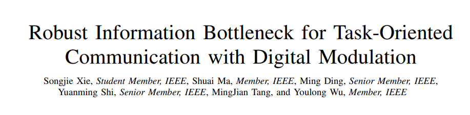
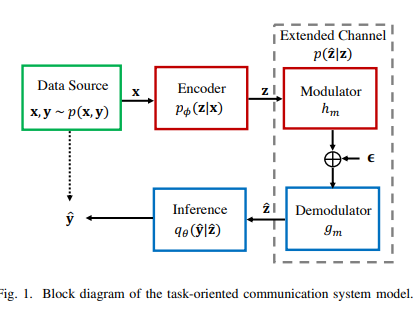
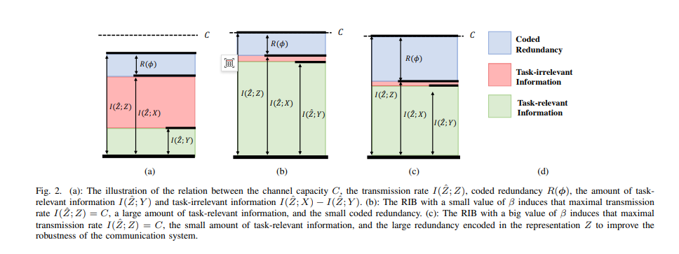
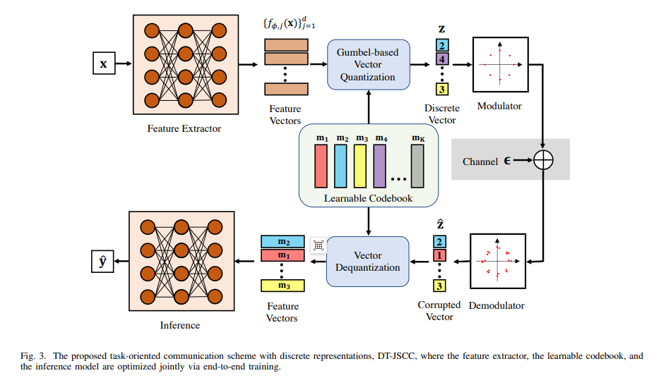
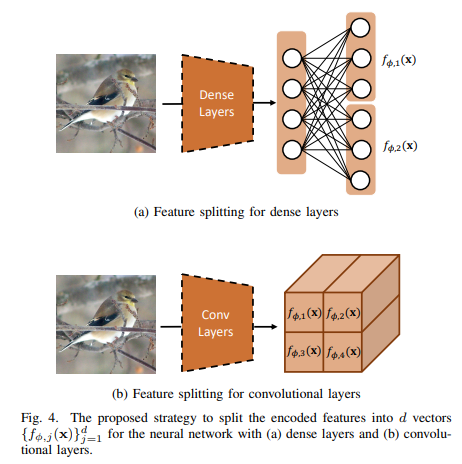
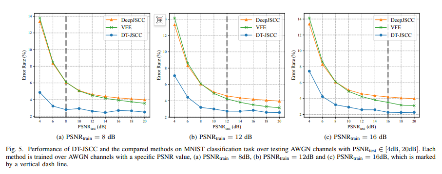
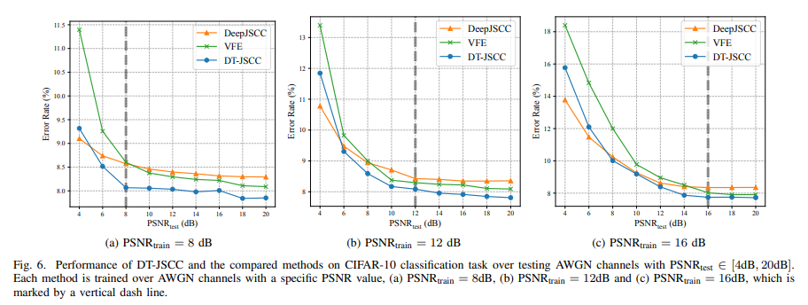
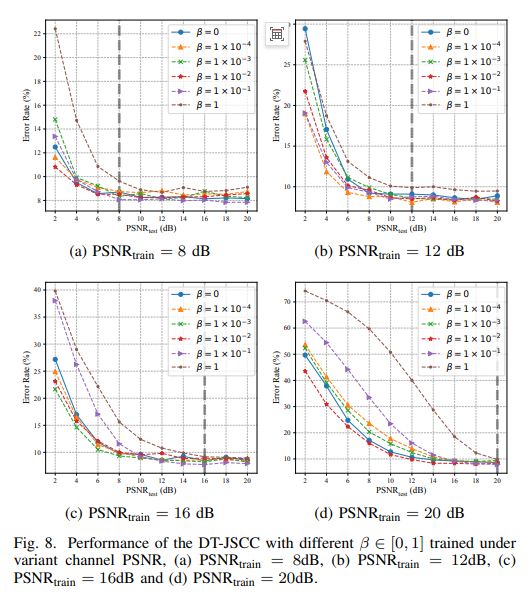

# Breakthrough in 6G Task-Based Communication: Robust Information Bottleneck + Digital Modulation, Making Edge Inference Stable and Fast[with Python code]

6G Task-Based Communication Breakthrough: Robust Information Bottleneck + Digital Modulation, Making Edge Inference Steady and Fast
In the wave of deep integration between 6G and AI, task-oriented communication is reshaping the traditional paradigm of bit transmission - no longer transmitting all data blindly but extracting key information for tasks, achieving low latency and high reliability edge collaborative inference.
However, the existing plan has been hindered by two major problems:
1  
Only transmit core information without redundancy, easily distorted during channel fluctuations, and has extremely poor robustness.
2  
The mainstream joint source channel coding (JSCC) outputs continuous features, which are incompatible with existing digital communication systems.
Today, I am sharing a top-tier research paper titled "Robust Information Bottleneck for Task-Oriented Communication with Digital Modulation," which proposes the Robust Information Bottleneck (RIB) + Discrete Task-Oriented Joint Source and Channel Coding (DT-JSCC), perfectly solving the dual challenges of robustness and compatibility. After reading this, you will undoubtedly open up new perspectives on task-oriented communication design.
📝 Summary of core information in the article: The title of the paper is "Robust Information Bottleneck for Task-Oriented Communication with Digital Modulation"
Core resolution: Insufficient robustness in task-based communication + Digital system incompatibility.
Core Innovation: Robust Information Bottleneck (RIB) Theory, Discrete Representation DT-JSCC Architecture
Deployment Value: Compatible with 5G/6G digital modulation, un-dropped chain under channel fluctuations, low latency edge deployment.
🔍 Abstract: In a nutshell, the core contribution lies in addressing the challenges faced by existing joint source-channel coding (JSCC) based on deep learning for AI-driven 6G task-oriented communication. This approach suffers from two major shortcomings: lack of robustness (lack of redundancy and susceptibility to channel interference), and digital system incompatibility (difficulty in adapting continuous features to digital modulation).
This paper first reveals the intrinsic trade-off between information encoding capacity and robustness, proposing a Robust Information Bottleneck (RIB) coding framework that enhances resilience against channel fluctuations through controllable coding redundancy; it also designs Discrete Task-based JSCC (DT-JSCC), which encodes features into discrete representations adapted for digital modulation, and derives an easily computable upper bound for the target function using variational inference.
Experiments prove: DT-JSCC outperforms baselines in image classification tasks with superior inference accuracy, lower communication latency, and strong robustness to channel variations.
🧠 Introduction: Why task-oriented communication is necessary? 1. Traditional vs. Task-oriented communication Traditional communication: Ensures bit error-free without considering semantics, leading to high redundancy and latency.
Task-oriented communication: Only extracts essential information for downstream tasks (such as classification or detection), achieving extreme compression and end-to-end low latency.
This is precisely the core requirement of 6G for scenarios like VR/AR, vehicle networking, smart healthcare, etc.
2. Two major fatal issues of existing JSCC based on DNN Although the performance of JSCC surpasses traditional separate compilation and coding, there are significant drawbacks:
1  
Robustness crisis: Overly compressing eliminates all redundancy, and channel noise or disturbances can directly destroy critical task information.
2  
Compatibility barrier: Outputting continuous features requires full resolution constellation modulation, which is incompatible with hardware of 5G and other digital communication systems.
3. Research objectives of this paper to establish a theory of balancing information volume and robustness
Design a task-oriented communication scheme compatible with digital modulation
Achieve low latency + high robustness + high precision edge reasoning
🛠️ Method details: From theory to architecture, dismantling the entire chain
I. Core Theory: Robust Information Bottleneck (RIB) This is the most inspiring theoretical innovation in the paper, redefining the optimization goal of task-oriented communication.
1. Limitations of traditional Information Bottleneck (IB) goals:
Only pursue retaining task information and compressing irrelevant information, completely abandoning redundancy, resulting in zero robustness.
2. RIB core formula (must see) The author proposes the RIB goal:
Ensure task-related information (guaranteeing inference accuracy)
Encoding redundancy (improving interference resistance)
Information Volume-Robustness Tradeoff Coefficient
Small: Prioritize Precision, Suitable for Stable Channels
Large: Prioritize Robustness, Suitable for Fluctuating Channels
Key insight: The transmission rate is limited by the channel capacity C, with the total sum of task information + irrelevant information + encoded redundancy fixed.
RIB's Wisdom: Minimize irrelevant information, allocate capacity to task information + controllable redundancy, without increasing communication overhead but significantly enhancing robustness.
Variational Upper Bound Derivation (Engineering Achievable) - Difficult to solve mutual information calculation; the author uses variational inference to obtain a trainable loss function:
First term: Inference Distortion (Classification Loss)
Second term: Maximize Transmission Robustness
Third term: Control Encoding Entropy, Balancing Information Volume
System Architecture: Discrete Task Type JSCC (DT-JSCC) Based on RIB, the author designs an end-to-end architecture fully compatible with digital modulation, solving compatibility issues.
Overall Process: Transmitter → Feature Extraction → Discrete Coding → Digital Modulation → Noise Channel → Demodulation → Deconvolution → Receiver Inference
Three key modules:
1. Feature splitting: High-dimensional features are equally divided into d low-dimensional vectors
Significantly reducing codebook size and lowering storage pressure at both transmitters and receivers
Fully connected layers based on vector splitting; convolutional layers based on channel splitting
2. Gumbel-Softmax Vector Quantization (Core) Learning Shared Codebooks
Features and codebooks inner product to obtain classification logits
Implement discrete representation training with Gumbel-Softmax
Output d-dimensional discrete vectors, perfectly adapted to digital modulation
3. Digital Modulation using K-point finite constellations (e.g., 16-PSK)
Substituting for continuous feature full resolution modulation
Directly compatible with existing 5G/6G digital communication hardware
Channel Model: AWGN
Training Algorithm (Easily summarized):
1. Small batch data forward, feature splitting → quantization → modulation → noisy → demodulation
2. Calculate VRIB loss
3. Backpropagation updates encoder, inferencing, shared codebooks
4.
Temperature annealing enables Gumbel-Softmax to approximate true discrete distributions.
📊 Experimental conclusion: Performance dominates baselines. Experimental setup: MNIST, CIFAR-10.
Comparative methods: DeepJSCC, VFE (current SOTA).
Channels: AWGN, PSNR 4–20dB.
Encoding dimensions d=16, latency 1.67ms.
1. Core results:
Higher inference accuracy.
MNIST: DT-JSCC achieves up to 97.93%, nearly 2% higher than DeepJSCC/VFE.
CIFAR-10: More pronounced advantage under low PSNR.
Robustness is extremely strong.
Accuracy decreases more gradually when training and testing PSNR mismatches.
Stability remains even with severe channel fluctuations.
2. Digital modulation friendliness.
16-PSK can achieve high performance without the need for complex hardware.
3. RIB effectiveness verification.
Significantly improves robustness without sacrificing accuracy.
Transmission rate approaches channel capacity, maximizing resource utilization.
Key conclusions from ablative experiments:
The more features split, the smaller codebook and higher accuracy, but there's a trade-off in latency.
Codebook size K≈16 offers the best cost-performance ratio.
Can be precisely controlled for robustness without a fixed optimal value, adaptable to different scenarios.
✅ Conclusion: Feasible path for 6G task-oriented communication.
1. Theoretical contribution proposes the robust information bottleneck RIB, first quantifying the trade-off between task-oriented communication information volume and robustness.
Derives a variational upper bound, enabling the engineering implementation of complex mutual information optimization.
2. Technological contribution introduces DT-JSCC, using discrete representations + digital modulation, compatible with existing mobile communication systems.
End-to-end training, low latency, high robustness, high accuracy.
3. Future prospects extend to multi-device collaborative inference.
Applied in generational AI, digital twins, metaverse, etc., for 6G scenarios.
For privacy-preserving task-oriented communication.
💡 Inspiration: This article gives us the core insight:
1.
Task-oriented communication is not about compression; controllable redundancy is key to robustness.
2  
Information theory + deep learning is a powerful tool to break through the bottlenecks of communication systems.
3  
Discrete representation is the bridge that integrates AI models with traditional digital communication.
The future 6G system must be a system that understands semantics, transmits steadily, and is well-compatible. The RIB+DT-JSCC initiative is a solid step in this direction.

## Images

<!-- PAYMENT_BLOCK -->

## Get this dataset

- Payment link (Stripe): [Buy now](https://buy.stripe.com/3cs8yP7sY87d0vu9AB)
- Payment QR code: 

<!-- /PAYMENT_BLOCK -->
